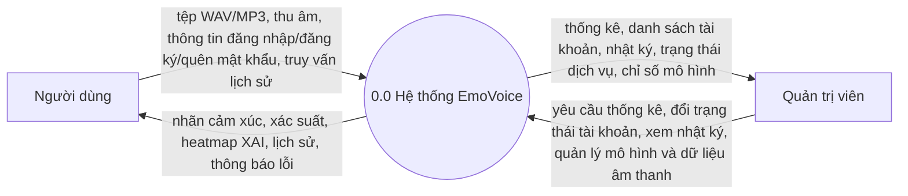
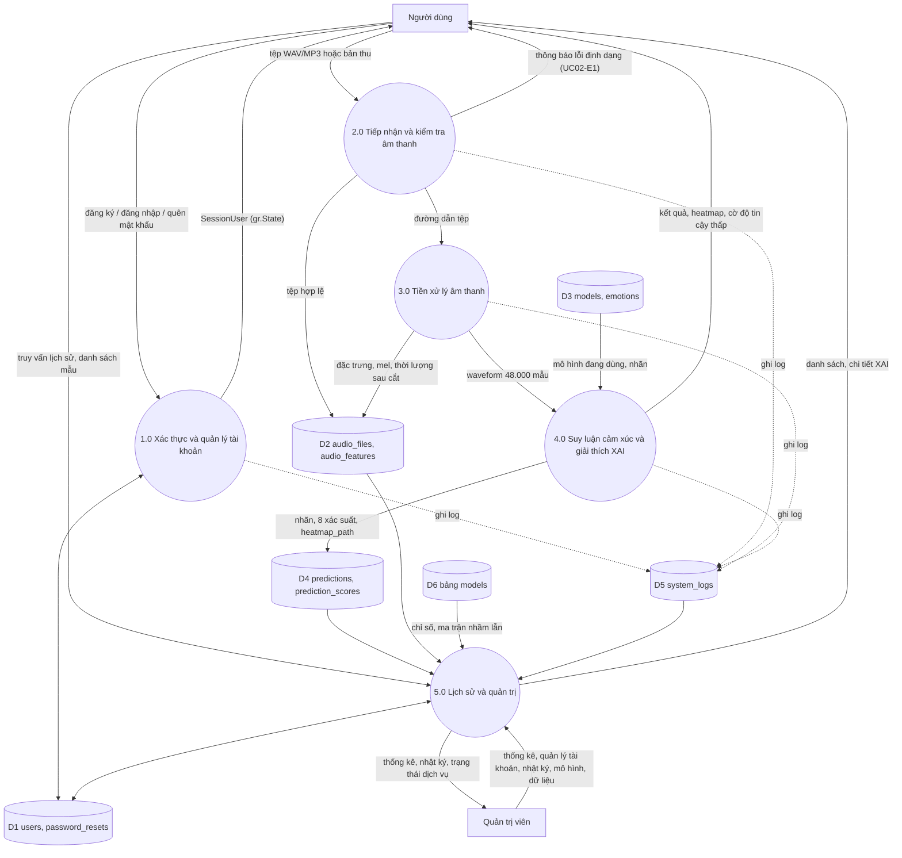

# Kiến trúc hệ thống EmoVoice (ứng dụng Gradio)

> Bản dựng từ báo cáo KLCN311 (Mục 2.1–2.3, 5.3) và đề cương (Ứng dụng demo: Web (Gradio)). Cần đối chiếu lại DFD với bản chính thức trong báo cáo. Skeleton FastAPI/React trước đó đã chuyển vào `_archive_old_skeleton/`.

## 1. Thành phần

| Thành phần | Vai trò | Vị trí |
|---|---|---|
| Ứng dụng Gradio (một tiến trình) | Giao diện user + admin, thu âm/tải tệp, hiển thị kết quả/heatmap; chạy bằng `python app.py` | `app.py`, `ui/` |
| Phiên đăng nhập | `SessionUser` lưu trong `gr.State` (phía server, theo từng tab trình duyệt); `require_login` / `require_admin` | `core/session.py` |
| Dịch vụ nghiệp vụ | Xác thực, kiểm tra tệp, điều phối pipeline, lịch sử, quản trị | `services/` |
| Package ML | Tiền xử lý, DistilHuBERT + LoRA, suy luận, XAI, đánh giá, benchmark | `ml/` |
| CSDL | 9 bảng (7 bảng báo cáo Mục 2.4 + `system_logs` + `password_resets`), SQLite khi dev | `models/`, `db/` |
| Kho tệp | Tệp tải lên, ảnh heatmap, ảnh Mel | `storage/` |
| Số liệu đánh giá | Đo thật bằng `ml/evaluate.py`, `ml/benchmark.py`, ghi vào bảng `models` (cột accuracy, f1_score, size_mb, inference_time, details) bởi `python -m ml.register_model`; UI chỉ đọc | `models`, `services/model_service.py` |

Phân lớp: `ui/pages` (sự kiện Gradio) → `services` (nghiệp vụ, kiểm tra quyền) → `ml` + `models`/`db` (hạ tầng). Trang UI không truy cập DB hay `ml` trực tiếp (ngoại lệ tạm thời trong skeleton: trang dùng dữ liệu mẫu khi service chưa cài đặt).

## 2. DFD mức 0 (sơ đồ ngữ cảnh)

## 3. DFD mức 1 (5 tiến trình)

| Tiến trình | UC | Code chính |
|---|---|---|
| 1.0 Xác thực và quản lý tài khoản | UC01 | `services/auth_service.py`, `core/security.py`, `ui/pages/login.py` |
| 2.0 Tiếp nhận và kiểm tra âm thanh | UC02 | `services/audio_service.py`, `ui/pages/analyze.py` (trạng thái 1) |
| 3.0 Tiền xử lý âm thanh | UC03, UC07 | `services/preprocessing_service.py`, `ml/preprocess.py` |
| 4.0 Suy luận cảm xúc và XAI | UC04 | `services/inference_service.py`, `services/xai_service.py`, `ml/inference.py`, `ml/xai.py` |
| 5.0 Lịch sử và quản trị | UC05, UC06 | `services/history_service.py`, `services/admin_service.py`, `services/system_status_service.py`, `services/model_service.py` |

## 4. Kiến trúc Gradio

- **Một app duy nhất** (`gr.Blocks`) gồm 2 view: `view-auth` (đăng nhập/đăng ký/quên mật khẩu) và `view-app` (sidebar + topbar + các trang). Sau đăng nhập `SessionUser` được lưu vào `gr.State`.
- **Chuyển trang**: sidebar là các `gr.Button` (`elem_classes=["ev-nav-btn"]`); mỗi trang là `gr.Column(visible=…, elem_id="page-…")`. Hàm `ui/layout.py::show_page(page_name, session)` cập nhật visibility toàn bộ trang, trạng thái active của sidebar, tiêu đề và breadcrumb, sau đó gọi `load_fn` của trang để nạp dữ liệu.
- **Phân quyền** (3 lớp): (1) nhóm "Quản trị hệ thống" trong sidebar chỉ bật cho Admin; (2) `show_page` chặn trang admin với người thường và đưa về trang Phân tích; (3) MỌI handler admin gọi `guard_admin` → `core.session.require_admin` ở phía server. Lớp (1) chỉ là UX.
- **Lưu ý của Gradio**: component `visible=False` vẫn nằm trong cấu hình gửi về trình duyệt nên không thể "không dựng" trang admin theo từng phiên. Vì vậy `build()` của trang admin chỉ tạo khung rỗng; dữ liệu chỉ được nạp qua `load_fn` sau khi `guard_admin` cho phép.
- **Giao diện**: `gr.Blocks(theme, css, head)` — theme tùy biến (`ui/theme.py`), CSS đọc từ `ui/css/*.css`, `head` nạp font Be Vietnam Pro, Inter, Material Symbols. Khối phức tạp dựng bằng `gr.HTML` từ `ui/templates/*.html`. Chế độ sáng được ép bằng `?__theme=light` + token theme không có biến thể tối.
- **Gradio 5 và 6**: từ Gradio 6, `theme/css/head` truyền ở `launch()` thay vì `gr.Blocks()`; `ui/theme.py::app_kwargs()` tự phát hiện bằng `inspect` nên cùng một code chạy được cả hai.

## 5. Luồng phân tích (UC02 → UC04)

1. Người dùng chọn tab "Tải tệp lên" (`gr.Audio(sources=["upload"], type="filepath")`) hoặc "Thu âm trực tiếp" (`sources=["microphone"]`), bấm "Thực hiện phân tích cảm xúc".
2. `audio_service.validate_upload`: đuôi tệp (`ALLOWED_AUDIO`), dung lượng (`MAX_UPLOAD_MB`), giải mã thử → lỗi hiển thị bằng toast `UC02-E1`.
3. Trang chuyển sang trạng thái "Đang xử lý" (generator `yield`): tiền xử lý (16 kHz mono, cắt lặng `top_db=25`, chuẩn hóa [-1, 1], cố định 48.000 mẫu) → ghi `audio_features` → `ml.inference.predict` → `(logits, probs, attn_weights[149])`.
4. `ml.xai` tạo heatmap 5 mức rời rạc (và attention trên Mel) → ghi `predictions` + 8 dòng `prediction_scores` → trang chuyển sang "Kết quả".
5. Nếu `max(probs) < LOW_CONFIDENCE_THRESHOLD` (0,30): hiện banner "độ tin cậy thấp".
6. Mô hình nạp một lần và giữ trong bộ nhớ; trạng thái hiển thị ở admin Tổng quan.

> Skeleton: bước 3–4 chưa cài đặt — nút phân tích hiển thị **kết quả mẫu cứng** kèm banner "Dữ liệu mẫu".

## 6. Yêu cầu phi chức năng

| Yêu cầu (báo cáo Mục 2.1.2) | Cách đáp ứng dự kiến |
|---|---|
| Suy luận + tiền xử lý < 1,5 s (đoạn 3 s) | Nạp mô hình một lần, `torch.no_grad()`, đo thời gian bằng `ml/benchmark.py` (warm-up + `torch.cuda.synchronize`), ghi `system_logs` |
| Mật khẩu phải băm | `bcrypt` (`core/security.py`); cột `users.password` chỉ lưu hash; mã đặt lại chỉ lưu SHA-256 |
| Kiểm tra tệp trước suy luận | `audio_service.validate_upload` (đuôi tệp, dung lượng, giải mã thử) |
| Cảnh báo "độ tin cậy thấp" khi mọi xác suất < 30% | `inference_service.is_low_confidence` + banner trong `ui/pages/analyze.py` |
| Phân quyền | `require_admin` ở mọi handler admin (xem mục 4) |
| Đổi CSDL | Chỉ đổi `DATABASE_URL` |
