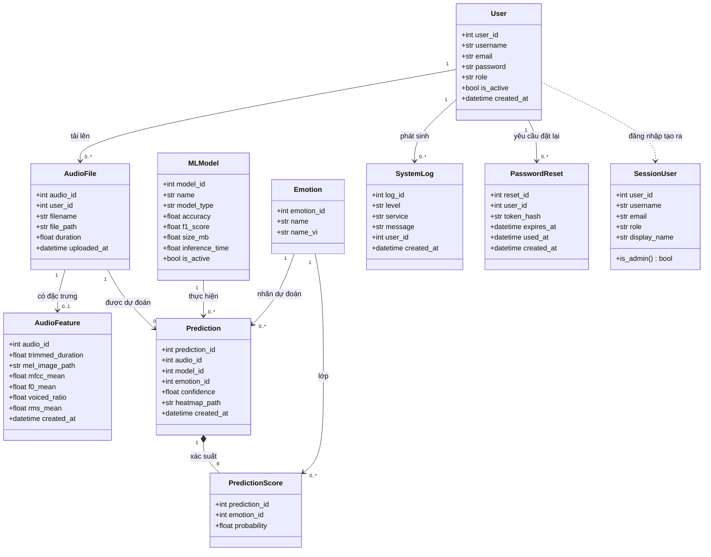

# Sơ đồ lớp thiết kế

Đề cương (thang điểm mục 4) yêu cầu "sơ đồ lớp thiết kế"; báo cáo hiện chưa có. Sơ đồ dưới dựng từ code thật của skeleton: lớp thực thể trong `models/`, lớp phiên trong `core/session.py`, mô-đun dịch vụ trong `services/` (biểu diễn dạng lớp `<<service>>` vì code là hàm cấp module), và hai lớp mô hình trong `ml/model.py`.

## 1. Lớp thực thể (models/) và phiên

## 2. Lớp dịch vụ (services/) và mô hình ML

```mermaid
classDiagram
    class AuthService {
        <<service>>
        +register(username, email, password, confirm) SessionUser
        +login(username_or_email, password) SessionUser
        +logout(session)
        +request_password_reset(email) str
        +reset_password(email, token, new_password)
    }
    class AudioService {
        <<service>>
        +validate_upload(file_path)
        +save_upload(session, file_path) AudioFile
        +get_audio_for_user(session, audio_id)
    }
    class PreprocessingService {
        <<service>>
        +preprocess_audio(file_path) ndarray
        +save_audio_features(audio_id, waveform)
        +compute_input_diagnostics(file_path) dict
    }
    class InferenceService {
        <<service>>
        +load_model_once()
        +run_inference(waveform) probs, attn
        +is_low_confidence(probs) bool
        +save_prediction(session, audio_id, probs, heatmap_path) Prediction
    }
    class XaiService {
        <<service>>
        +build_waveform_heatmap(waveform, attn, real_duration) str
        +build_mel_attention(waveform, attn) str
    }
    class HistoryService {
        <<service>>
        +list_history(session, page, page_size, emotion, days, q)
        +get_history_detail(session, prediction_id)
        +list_audio_samples(session, q, emotion)
    }
    class ModelService {
        <<service>>
        +load_metrics() dict
        +load_confusion_matrix(model_key) dict
        +list_models_from_db()
        +set_active_model(session, model_id)
    }
    class AdminService {
        <<service>>
        +get_stats(session)
        +list_users(session, page, page_size, q)
        +set_user_status(session, user_id, is_active)
        +list_logs(session, page, page_size, level, on_date, q)
        +list_all_audio(session, page, page_size, q, emotion)
        +delete_audio(session, audio_id)
    }
    class SystemStatusService {
        <<service>>
        +get_system_status(session)
    }
    class TemporalAttentionPooling {
        +Linear projection 768 to 1
        +forward(hidden_states) pooled, attn_weights
    }
    class DistilHuBERTForSER {
        +backbone DistilHuBERT frozen
        +lora r=8 alpha=16 q_proj v_proj
        +pooling TemporalAttentionPooling
        +head 768-256-GELU-LayerNorm-Dropout-8
        +forward(input_values) logits, attn_weights
    }

    DistilHuBERTForSER *-- TemporalAttentionPooling
    AuthService ..> User
    AuthService ..> PasswordReset
    AuthService ..> SystemLog
    AudioService ..> AudioFile
    PreprocessingService ..> AudioFeature
    InferenceService ..> DistilHuBERTForSER : ml.inference
    InferenceService ..> Prediction
    InferenceService ..> PredictionScore
    XaiService ..> TemporalAttentionPooling : attn_weights 149 khung
    HistoryService ..> Prediction
    HistoryService ..> AudioFile
    ModelService ..> MLModel
    AdminService ..> User
    AdminService ..> SystemLog
    AdminService ..> AudioFile
    AdminService ..> SessionUser : require_admin
    SystemStatusService ..> SystemLog
```

Ghi chú: `AdminService` là chỗ duy nhất các thao tác quản trị đi qua; mỗi hàm nhận `SessionUser` và phải gọi `require_admin` trước khi truy cập dữ liệu. Các lớp pipeline ML (`ml.preprocess`, `ml.xai`, `ml.evaluate`, `ml.benchmark`) là hàm cấp module nên không đưa vào sơ đồ lớp.
