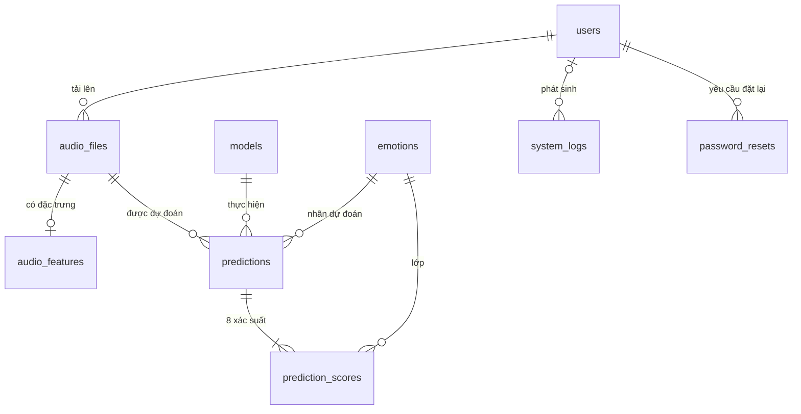

# Cơ sở dữ liệu

9 bảng: **7 bảng theo báo cáo Mục 2.4** (`users`, `audio_files`, `audio_features`, `models`, `emotions`, `predictions`, `prediction_scores`) + **2 bảng bổ sung** `system_logs`, `password_resets`.

> **Hai bảng bổ sung CHƯA có trong báo cáo Mục 2.4** (cần bổ sung vào báo cáo hoặc loại bỏ): `system_logs` phục vụ UC06 (trang admin Nhật ký hệ thống) và `password_resets` phục vụ UC01 "Quên mật khẩu" (đề cương tuần 9). Định nghĩa cột đầy đủ nằm trong `models/`.

## users
| Cột | Kiểu | Ràng buộc |
|---|---|---|
| user_id | INT | PK |
| username | VARCHAR(50) | UNIQUE, NOT NULL |
| email | VARCHAR(255) | UNIQUE, NOT NULL |
| password | VARCHAR(255) | NOT NULL — **hash bcrypt**, không lưu mật khẩu thô |
| role | VARCHAR(10) | `User` \| `Admin`, mặc định `User` |
| is_active | BOOLEAN | mặc định true |
| created_at | DATETIME | mặc định thời điểm tạo |

## audio_files (users 1–n audio_files)
| Cột | Kiểu | Ràng buộc |
|---|---|---|
| audio_id | INT | PK |
| user_id | INT | FK → users.user_id |
| filename | VARCHAR(255) | tên gốc người dùng tải lên |
| file_path | VARCHAR(500) | đường dẫn trong `storage/uploads/` |
| duration | FLOAT | giây |
| uploaded_at | DATETIME | |

## audio_features (1–1 với audio_files)
| Cột | Kiểu | Ràng buộc |
|---|---|---|
| audio_id | INT | PK, FK → audio_files.audio_id |
| trimmed_duration | FLOAT | thời lượng sau cắt lặng (giây) |
| mel_image_path | VARCHAR(500) | ảnh Mel trong `storage/mel/` |
| mfcc_mean | FLOAT | |
| f0_mean | FLOAT | |
| voiced_ratio | FLOAT | |
| rms_mean | FLOAT | |
| created_at | DATETIME | |

## models
| Cột | Kiểu | Ràng buộc |
|---|---|---|
| model_id | INT | PK |
| name | VARCHAR(100) | UNIQUE |
| model_type | VARCHAR(50) | Cổ điển / Mạng sâu / Transformer |
| accuracy | FLOAT | % |
| f1_score | FLOAT | % (macro) |
| size_mb | FLOAT | MiB (checkpoint) |
| inference_time | FLOAT | **ms/mẫu** (báo cáo Bảng 5.4). Skeleton cũ ghi "giây"; đã đổi sang ms vì mọi số liệu báo cáo tính bằng ms |
| is_active | BOOLEAN | chỉ 1 dòng true (unique index một phần) |

Dữ liệu seed (`db/seed.py`, số liệu báo cáo): Random Forest 52,22 / 48,11 / 0,09 ms; XGBoost 48,89 / 47,07 / 0,04 ms; 1D-CNN 36,11 / 29,47 / 4,16 ms (34.120 tham số); Bi-LSTM 36,67 / F1 **TODO** (143.944 tham số); **DistilHuBERT + LoRA 73,33 / 71,21 / 7,60 ms, 90,6 MiB, 249.353 / 23.741.321 tham số huấn luyện (1,05%), `is_active = 1`**.

> Số liệu Bi-LSTM chưa chốt: Bảng 5.1 ghi F1 = 32,80, Mục 4.2 / Bảng 4.6 ghi 33,37, báo cáo còn nêu lần chạy chính 38,33 / 37,05. Độ trễ 1D-CNN: Bảng 5.4 ghi 4,16 ms, Bảng 4.6 ghi 1,19 ms.

## emotions
| emotion_id | name | name_vi |
|---|---|---|
| 0 | neutral | Trung tính |
| 1 | calm | Êm đềm |
| 2 | happy | Vui vẻ |
| 3 | sad | Buồn bã |
| 4 | angry | Tức giận |
| 5 | fearful | Sợ hãi |
| 6 | disgust | Chán ghét |
| 7 | surprised | Ngạc nhiên |

`emotion_id` trùng chỉ số lớp của mô hình (0–7), không tự tăng.

## predictions
| Cột | Kiểu | Ràng buộc |
|---|---|---|
| prediction_id | INT | PK |
| audio_id | INT | FK → audio_files.audio_id |
| model_id | INT | FK → models.model_id |
| emotion_id | INT | FK → emotions.emotion_id (nhãn xác suất cao nhất) |
| confidence | FLOAT | xác suất của nhãn dự đoán |
| heatmap_path | VARCHAR(500) | ảnh trong `storage/heatmaps/` |
| created_at | DATETIME | |

Cờ `low_confidence` không lưu cột riêng; suy ra từ `confidence < LOW_CONFIDENCE_THRESHOLD` (0,30).

## prediction_scores
| Cột | Kiểu | Ràng buộc |
|---|---|---|
| prediction_id | INT | PK (kép), FK → predictions.prediction_id |
| emotion_id | INT | PK (kép), FK → emotions.emotion_id |
| probability | FLOAT | 0..1; 8 dòng cho mỗi lượt dự đoán, tổng ≈ 1 |

## system_logs (BỔ SUNG)
| Cột | Kiểu | Ràng buộc |
|---|---|---|
| log_id | INT | PK |
| level | VARCHAR(10) | `INFO` \| `WARNING` \| `ERROR` |
| service | VARCHAR(50) | ví dụ `auth`, `preprocess`, `inference`, `model_loader` |
| message | TEXT | |
| user_id | INT | FK → users.user_id, nullable |
| created_at | DATETIME | |

## password_resets (BỔ SUNG)
| Cột | Kiểu | Ràng buộc |
|---|---|---|
| reset_id | INT | PK |
| user_id | INT | FK → users.user_id |
| token_hash | VARCHAR(128) | SHA-256 của mã đặt lại (không lưu mã thô) |
| expires_at | DATETIME | `created_at + PASSWORD_RESET_TTL_MINUTES` |
| used_at | DATETIME | nullable; có giá trị = mã đã dùng |
| created_at | DATETIME | |

## Ghi chú
- SQLite cần `PRAGMA foreign_keys=ON` (đặt trong `db/session.py`).
- Chưa dùng Alembic; `db/init_db.py` gọi `Base.metadata.create_all`. Nên thêm Alembic trước khi chuyển PostgreSQL thật.
- Chỉ số mô hình hiển thị trên giao diện **đọc từ `assets/metrics/*.json`**; bảng `models` là nguồn dự kiến sau khi `model_service.list_models_from_db` được cài đặt (cần đồng bộ hai nguồn).
